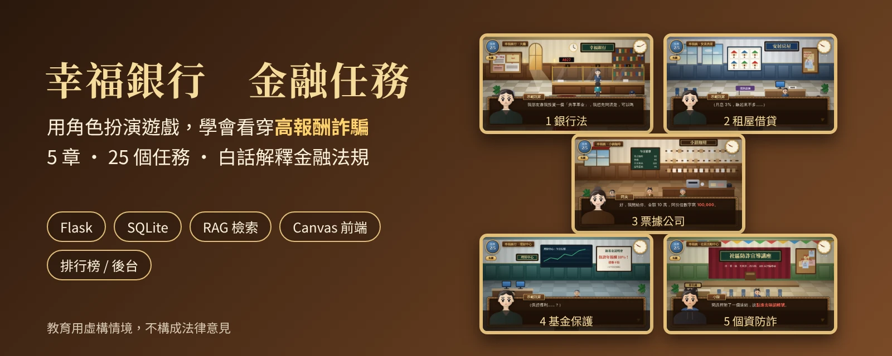
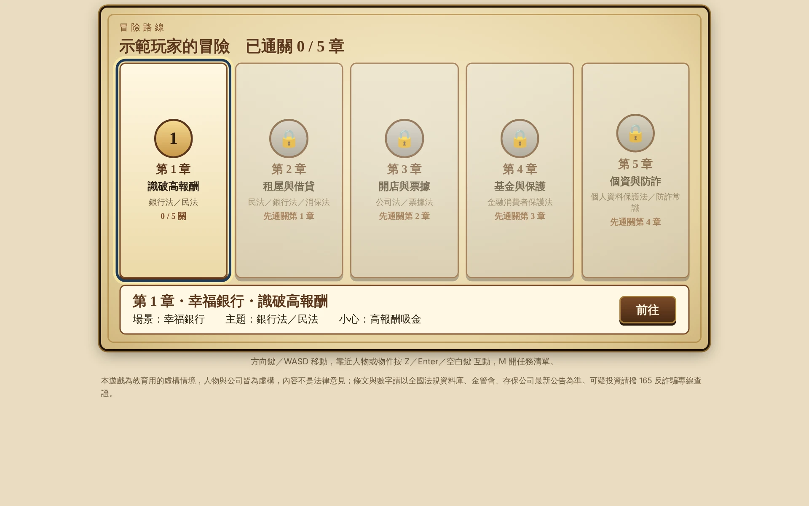
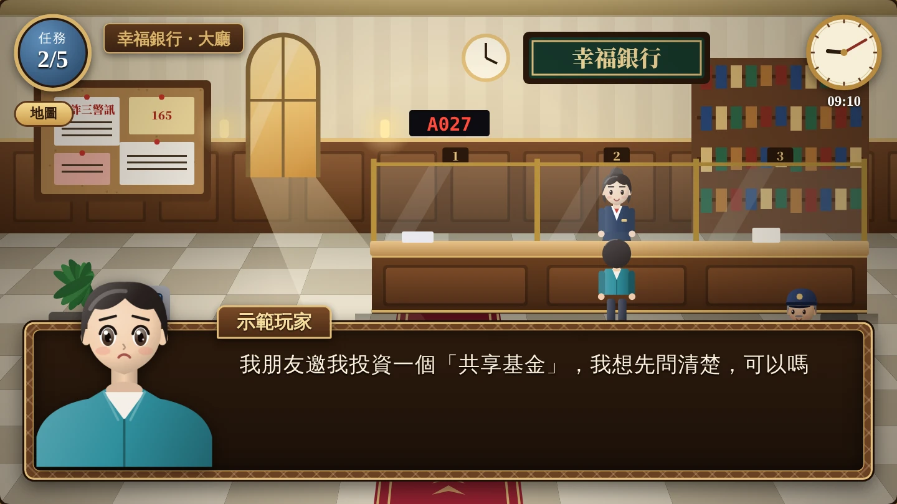
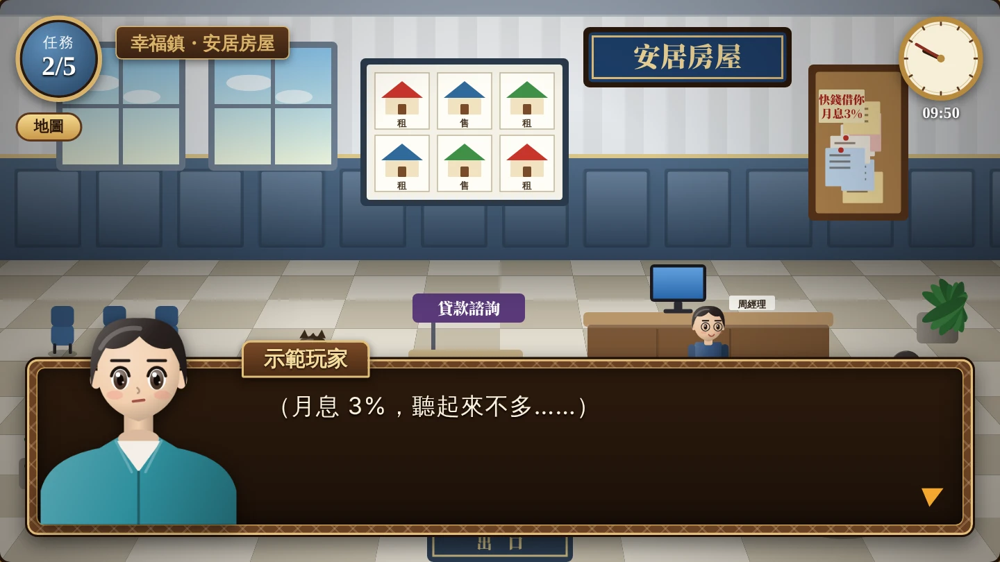
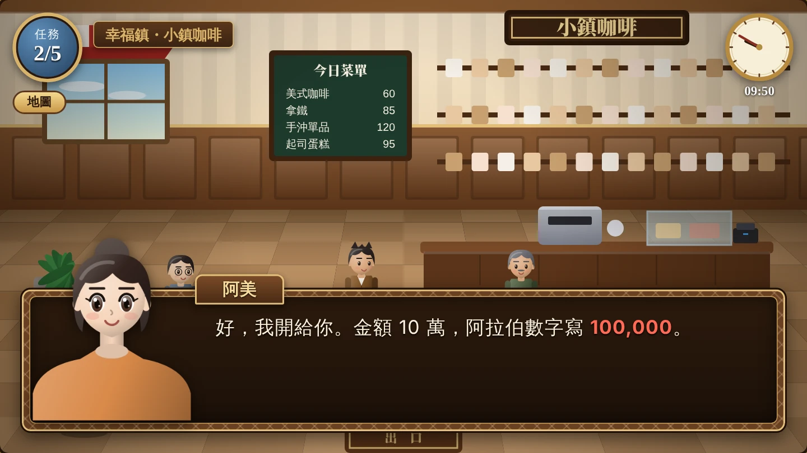
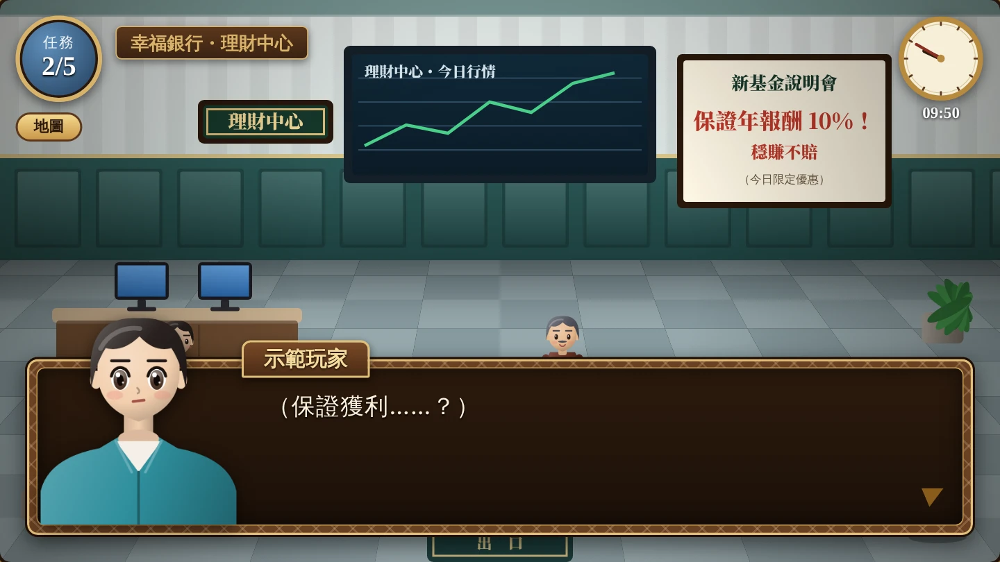
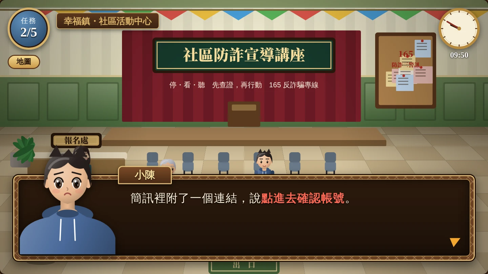
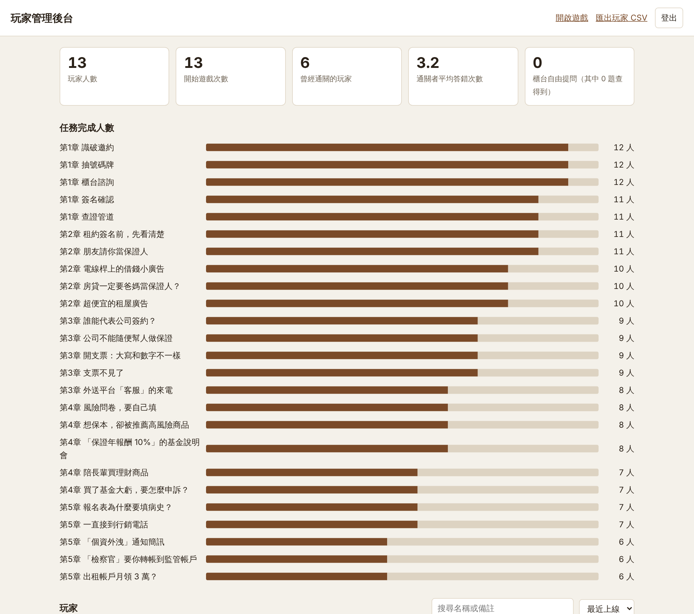
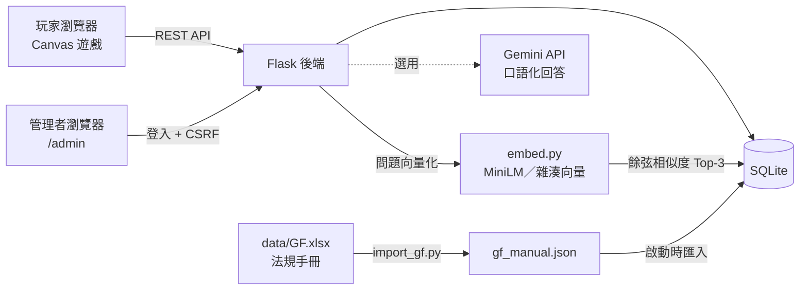
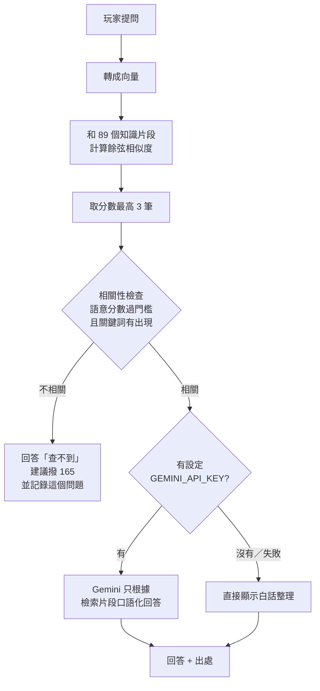

# 幸福銀行 金融任務 Bank Quest



> 用角色扮演遊戲，學會看穿高報酬詐騙。
> 5 章 · 25 個任務 · 用白話解釋金融法規

**🎮 線上試玩：<https://bank-quest.onrender.com>**


> 免費主機閒置一段時間會休眠，第一次打開可能要等 30～60 秒。

---

## 目錄

- [專案簡介](#專案簡介)
- [遊戲畫面](#遊戲畫面)
- [核心功能](#核心功能)
- [技術架構](#技術架構)
- [RAG 法規問答怎麼運作](#rag-法規問答怎麼運作)
- [資料庫設計](#資料庫設計)
- [API 一覽](#api-一覽)
- [專案結構](#專案結構)
- [本機執行](#本機執行)
- [部署到 Render](#部署到-render)
- [環境變數](#環境變數)
- [內容怎麼改](#內容怎麼改)
- [安全性設計](#安全性設計)
- [限制與未來規劃](#限制與未來規劃)
- [聲明](#聲明)

---

## 專案簡介

投資詐騙、假檢警、出租帳戶……這些手法每年讓很多人受害，但「銀行法」、「金融消費者保護法」這類條文對一般人來說太難讀。

**幸福銀行 金融任務** 把法規知識包裝成一款網頁角色扮演遊戲：玩家在小鎮裡走動、和 NPC 對話，遇到「保證年報酬 10%」、「月息 3% 快錢借你」、「個資外洩通知簡訊」等情境時，要選出正確的應對方式。每一關結束後，遊戲會用白話整理出這一關對應的法規重點。

遊戲裡也有一個銀行櫃台，玩家可以直接用自己的話發問（例如「朋友找我投資共享基金可以嗎？」），系統會從法規知識庫檢索最相關的條文，並附上出處回答。

**這個專案展示了：**

- 從遊戲企劃、劇本、關卡設計到前後端實作的完整開發流程
- 以 **RAG（檢索增強生成）** 建立有出處、可追溯的法規問答
- 玩家資料、排行榜與管理後台的設計
- 雲端部署（Render Blueprint，基礎設施即程式碼）

---

## 遊戲畫面

### 闖關路線

輸入名稱 → 前情提要 → 選擇章節出發。章節依序解鎖，隨時可按 `G` 打開地圖。



### 五大章節

| 章節 | 場景 | 主題法規 | 要小心的詐騙 |
|---|---|---|---|
| 第 1 章 識破高報酬 | 幸福銀行 | 銀行法／民法 | 高報酬吸金 |
| 第 2 章 租屋與借貸 | 安居房屋 | 民法／銀行法／消保法 | 高利貸、保證人陷阱、假租屋 |
| 第 3 章 開店與票據 | 小鎮咖啡 | 公司法／票據法 | 支票糾紛、假客服 |
| 第 4 章 基金與保護 | 理財中心 | 金融消費者保護法 | 保證獲利、不當推銷 |
| 第 5 章 個資與防詐 | 社區活動中心 | 個人資料保護法／防詐常識 | 假檢察官、釣魚簡訊、出租帳戶 |

<table>
  <tr>
    <td width="50%"><br><sub><b>第 1 章</b>：朋友邀你投資「共享基金」，先到銀行問清楚</sub></td>
    <td width="50%"><br><sub><b>第 2 章</b>：「月息 3%」聽起來不多？換算年利率就知道了</sub></td>
  </tr>
  <tr>
    <td width="50%"><br><sub><b>第 3 章</b>：開支票時，大寫和數字金額不一樣怎麼辦</sub></td>
    <td width="50%"><br><sub><b>第 4 章</b>：「保證年報酬 10%、穩賺不賠」的基金說明會</sub></td>
  </tr>
  <tr>
    <td width="50%"><br><sub><b>第 5 章</b>：簡訊附連結說要「確認帳號」</sub></td>
    <td width="50%"><br><sub><b>管理後台</b>：玩家人數、通關率、每一關的完成人數</sub></td>
  </tr>
</table>

---

## 核心功能

### 🎮 遊戲

- **25 個任務**：每關都有劇情、NPC 對話與選擇題；答錯會立刻說明錯在哪裡，選項順序每次隨機。
- **白話法規**：每一條法規都整理成三段：「白話說明」、「生活例子」、「您可以這樣做」。
- **法規手冊**：在櫃台可以翻閱 64 條法規，能依法規分類篩選、用關鍵字搜尋，也能展開看完整條文。
- **櫃台自由提問**：用自己的話發問，系統用 RAG 找出相關條文回答並標示出處；查不到時會誠實說查不到，並建議撥打 165。
- **計分與排行榜**：滿分 1000 分，答錯一次扣 20 分；通關後顯示前 10 名和自己的名次。分數由伺服器計算，避免前端竄改。
- **進度保存**：玩家憑證存在瀏覽器，同一台裝置再玩會延續同一筆紀錄。

### 🛠 管理後台（`/admin`）

- **統計**：玩家人數、開始遊戲次數、通關人數、通關者平均答錯次數。
- **任務完成漏斗**：25 關各有多少人完成，可以看出玩家在哪一關卡住。
- **玩家管理**：搜尋、排序、改名、加備註、重設進度、刪除，並可匯出 CSV（Excel 可直接開）。
- **提問紀錄**：看玩家問了什麼，並篩出「知識庫答不出來」的問題，作為補充資料的依據。

---

## 技術架構

| 層級 | 使用技術 |
|---|---|
| 前端 | HTML5 Canvas、原生 JavaScript（不使用框架）、CSS |
| 後端 | Python 3.12、Flask 3、Gunicorn |
| 資料庫 | SQLite（法規知識庫、玩家、事件、提問紀錄） |
| 檢索 | NumPy 向量餘弦相似度；可選 sentence-transformers 多語言模型 |
| 生成（選用） | Google Gemini API（只根據檢索結果改寫成口語） |
| 部署 | Render（`render.yaml` Blueprint，push 到 GitHub 即自動部署） |



---

## RAG 法規問答怎麼運作



設計重點：

1. **知識庫**：64 條法規和 6 則法規總覽來自 `GF.xlsx` 法規遵循手冊，再加上遊戲內建的核心條文，共 89 個片段。每個片段都有出處（例如「銀行法 §29」）。
2. **向量化**：預設使用不需要額外套件的「字元二元組雜湊向量」。安裝 `sentence-transformers` 後會自動改用 `paraphrase-multilingual-MiniLM-L12-v2`；換了模型，啟動時會自動重算向量。
3. **雙重相關性檢查**：除了語意分數要夠高，問題的關鍵詞也必須真的出現在條文中，避免回答「看起來很像、其實無關」的條文。語意分數特別高時（例如問「吸金」、條文寫「收受存款」）可以免除字面條件。
4. **防止 AI 亂編**：Gemini 只能根據檢索到的片段回答，被要求在 120 字以內；資料沒提到的內容要說不確定。API 失敗時會自動退回顯示原文，遊戲不會壞掉。
5. **持續改善**：答不出來的問題會被記錄下來，在後台一鍵篩選，作為補充知識庫的依據。

---

## 資料庫設計

| 資料表 | 用途 |
|---|---|
| `chunks` | RAG 知識片段：內容、出處、向量（float32 BLOB）、產生向量的模型名稱 |
| `manual` | 法規手冊：條號、摘要、檢核重點、常見違規、法律效果、白話三段 |
| `game_qa` / `learn` | 櫃台預設問題、「學到的重點」 |
| `players` | 玩家：名稱、憑證、遊玩次數、完成任務、答錯次數、最高分 |
| `events` | 事件紀錄（完成任務、通關），供後台統計使用 |
| `questions` | 自由提問紀錄，以及是否答得出來 |

完整定義見 [`schema.sql`](schema.sql)。

---

## API 一覽

| 方法 | 路徑 | 說明 |
|---|---|---|
| GET | `/` | 遊戲首頁 |
| GET | `/api/content` | 第 1 章內容、櫃台問答 |
| GET | `/api/chapters` | 第 2～5 章關卡資料 |
| GET | `/api/manual` | 法規手冊 |
| POST | `/api/player` | 建立或延續玩家（`name`、`id`、`token`） |
| POST | `/api/progress` | 回報進度、答錯次數、是否通關 |
| POST | `/api/ask` | 櫃台自由提問（RAG） |
| GET | `/api/leaderboard` | 排行榜前 10 名與自己的名次 |
| GET | `/api/health` | 健康檢查：知識片段數、向量模型、是否啟用 LLM |
| GET | `/admin` | 管理後台（需要密碼） |
| GET | `/admin/players.csv` | 匯出玩家 CSV |

---

## 專案結構

```
bank-quest-app/
├─ app.py              Flask 後端：遊戲 API、玩家 API、RAG 問答、後台
├─ db.py               SQLite 存取、建表、匯入資料、語意檢索、計分與排行榜
├─ embed.py            文字向量化（MiniLM；沒安裝時改用雜湊向量）
├─ schema.sql          資料表定義
├─ import_gf.py        把 data/GF.xlsx 轉成 data/gf_manual.json
├─ render.yaml         Render 部署設定（Blueprint）
├─ requirements.txt
├─ data/
│  ├─ seed.json        內建知識片段、櫃台預設問題、學到的重點
│  ├─ chapters.json    第 2～5 章：角色、劇情、題目
│  ├─ plain.json       每條法規的白話三段與日常用語同義詞
│  ├─ GF.xlsx          銀行法規遵循手冊（六大法規）
│  └─ gf_manual.json   由 GF.xlsx 轉出，啟動時匯入資料庫
├─ templates/          index.html（遊戲）、admin.html、admin_login.html
├─ static/             css/game.css、js/game.js、css/admin.css、js/admin.js
└─ docs/images/        README 用的截圖
```

---

## 本機執行

需要 Python 3.10 以上。

```powershell
git clone https://github.com/b3879121-rgb/bank-quest.git
cd bank-quest
python -m venv .venv
.\.venv\Scripts\Activate.ps1        # macOS／Linux：source .venv/bin/activate
pip install -r requirements.txt
$env:ADMIN_PASSWORD = "換成你自己的密碼"   # macOS／Linux：export ADMIN_PASSWORD=...
python app.py
```

- 遊戲：<http://127.0.0.1:5000>
- 後台：<http://127.0.0.1:5000/admin>
- 第一次啟動會自動建立 `bankquest.db`，並為知識庫建立向量。
- 沒設定 `ADMIN_PASSWORD` 時，終端機會印出這次啟動的臨時密碼。

**選用：改用真正的語意模型**

```powershell
pip install sentence-transformers
python app.py
```

第一次會下載模型。檢索門檻會自動換成適合該模型的數值。

---

## 部署到 Render

專案附有 [`render.yaml`](render.yaml)，可以一鍵部署：

1. 把專案推到自己的 GitHub。
2. 在 Render 選 **New → Blueprint**，連結這個 repo。
3. 依提示填入 `ADMIN_PASSWORD`；`SECRET_KEY` 會自動產生。
4. 按 Apply，等狀態變成 **Live**。

之後只要 `git push`，Render 就會自動重新部署。

部署設定說明：

- 使用 **Gunicorn**，設定 1 個 worker、4 個 thread。SQLite 適合單一程序寫入，用多執行緒處理同時連線。
- `healthCheckPath: /api/health`，Render 會用它判斷服務是否正常。

---

## 環境變數

| 變數 | 必填 | 說明 |
|---|---|---|
| `ADMIN_PASSWORD` | 建議 | 後台密碼；沒設定時每次啟動產生臨時密碼 |
| `SECRET_KEY` | 建議 | Flask session 金鑰；沒設定時每次啟動隨機產生 |
| `GEMINI_API_KEY` | 選用 | 設定後，櫃台回答會由 Gemini 改寫成口語 |
| `GEMINI_MODEL` | 選用 | 預設 `gemini-flash-lite-latest` |
| `BANKQUEST_DB` | 選用 | SQLite 檔案路徑，預設為專案資料夾下的 `bankquest.db` |
| `BANKQUEST_EMBED` | 選用 | 設成 `hash` 時強制使用雜湊向量 |
| `BANKQUEST_SCORE_MIN` | 選用 | 檢索相關性門檻 |

---

## 內容怎麼改

| 想改的內容 | 檔案 | 改完要做什麼 |
|---|---|---|
| 法規手冊 | `data/GF.xlsx` | 執行 `python import_gf.py`，再重新啟動 |
| 白話說明、生活例子 | `data/plain.json` | 重新啟動（只會重算有變動的片段） |
| 第 2～5 章劇情與題目 | `data/chapters.json` | 重新整理頁面 |
| 第 1 章劇情、關卡座標 | `static/js/game.js` 的 `STORY`、`STG` | 重新整理頁面 |
| 計分方式 | `db.score_of()` 與 `game.js` 的 `scoreOf()` | 兩處要一起改 |

`plain.json` 格式：

```json
"CV-04": ["白話說明", "生活例子", "您可以這樣做"]
```

key 是手冊編號（BK-01、CV-04…）或核心條文 id；`_tags` 放日常用語同義詞（例如「掉了、弄丟」對應「喪失」），讓一般人的說法也找得到條文。

新增關卡：在 `chapters.json` 的 `missions` 加一筆即可，後台統計會自動更新。每關欄位包含 `id, name, npc, x, y, stand, label, desc, hint, intro, quiz, outro, learn, again`。

---

## 安全性設計

- 後台密碼以 `secrets.compare_digest` 比對；登入失敗延遲 1 秒，減緩暴力猜測。
- 後台的寫入動作需要帶 CSRF 憑證。
- Session Cookie 設定 `HttpOnly`、`SameSite=Lax`。
- 玩家只能用自己的憑證（token）更新自己的紀錄。
- 分數由伺服器依答錯次數計算，不信任前端傳來的分數。
- 匯出 CSV 時，會跳脫 `= + - @` 開頭的內容，避免 Excel 公式注入。
- 所有使用者輸入在畫面上一律轉義，防止 XSS。
- 密碼、金鑰都用環境變數設定，不寫進程式碼。

---

## 限制與未來規劃

| 現況 | 原因 | 正式環境的做法 |
|---|---|---|
| 服務重新部署或重啟後資料會清空 | 免費方案使用容器內的 SQLite 檔案 | 改用 PostgreSQL 或掛載永久磁碟 |
| 閒置後第一次開啟較慢 | 免費方案會休眠 | 升級付費方案，或用排程定時喚醒 |
| 預設使用雜湊向量，語意理解有限 | 免費方案記憶體不足以載入語意模型 | 改用 MiniLM 或雲端 embedding API |
| `/api/ask` 沒有頻率限制 | 展示用途 | 加上 rate limiting（例如 Flask-Limiter） |

---

## 聲明

本遊戲為教育用途的虛構情境，人物與公司皆為虛構，內容不構成法律意見。條文與數字（如存款保險 300 萬元、民法利率上限 16% 等）為教育用整理，請以全國法規資料庫、金管會、中央存保公司最新公告為準。

遇到可疑的投資或來電，請撥打 **165 反詐騙專線** 查證。
